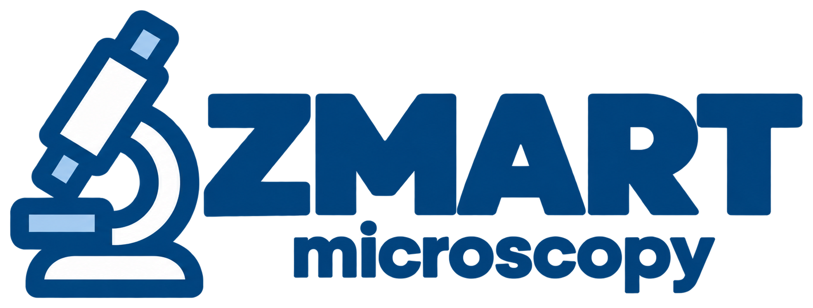
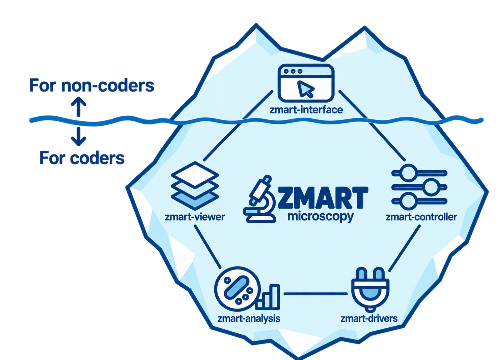

# ZMART Microscopy

**ZMART** (ZMB's Microscopy-Agnostic Research Toolkit) is the set of tools we use for smart microscopy
at the Center for Microscopy and Image Analysis (ZMB), University of Zurich.
This repository contains example workflows that you can implement on our microscopes.
It also contains an overview of the individual tools of the ZMART toolkit.
 

## Example workflows

### For coders

- [Target acquisition workflow for the Leica STELLARIS](workflows/for-coders/) using a Jupyter notebook

### For non-coders

- [Target acquisition workflow](workflows/for-non-coders/) using an intuitive interface

### Build your own workflow with ZMART

Each tool has its own repository and can be used on its own.

<table>
<tr>
<td width="46%" valign="middle">

</td>
<td valign="middle">

<a href="https://github.com/ZMB-UZH/ZMART-drivers"><b>ZMART drivers</b></a> 
One driver per microscope (Leica, Nikon, ZEISS, mesoSPIM), each translating the controller's commands into what that microscope understands

<a href="https://github.com/ZMB-UZH/ZMART-controller"><b>ZMART Controller</b></a> 
A short list of plain commands (move, read the state, acquire) that works the same on every microscope with a driver

<a href="https://github.com/ZMB-UZH/ZMART-interface"><b>ZMART interface</b></a> 
Scan an overview, find targets, image them again

<a href="https://github.com/ZMB-UZH/ZMART-analysis"><b>ZMART analysis</b></a> 
The analysis engine that runs between acquisitions (focus, object detection), each step in its own environment

<a href="https://github.com/ZMB-UZH/ZMART-viewer"><b>ZMART viewer</b></a> 
Shows a run as OME-Zarr while it is still being acquired

<a href="https://github.com/thomdehoog/ZMART-ai-agent"><b>ZMART AI agent</b></a> 
Drives a microscope when you ask in your own words

</td>
</tr>
</table>

## Author
Thom de Hoog, Center for Microscopy and Image Analysis (ZMB), University of
Zurich (thom.dehoog@zmb.uzh.ch, thomdehoog@gmail.com).

## License
MIT License. See LICENSE file for details.
