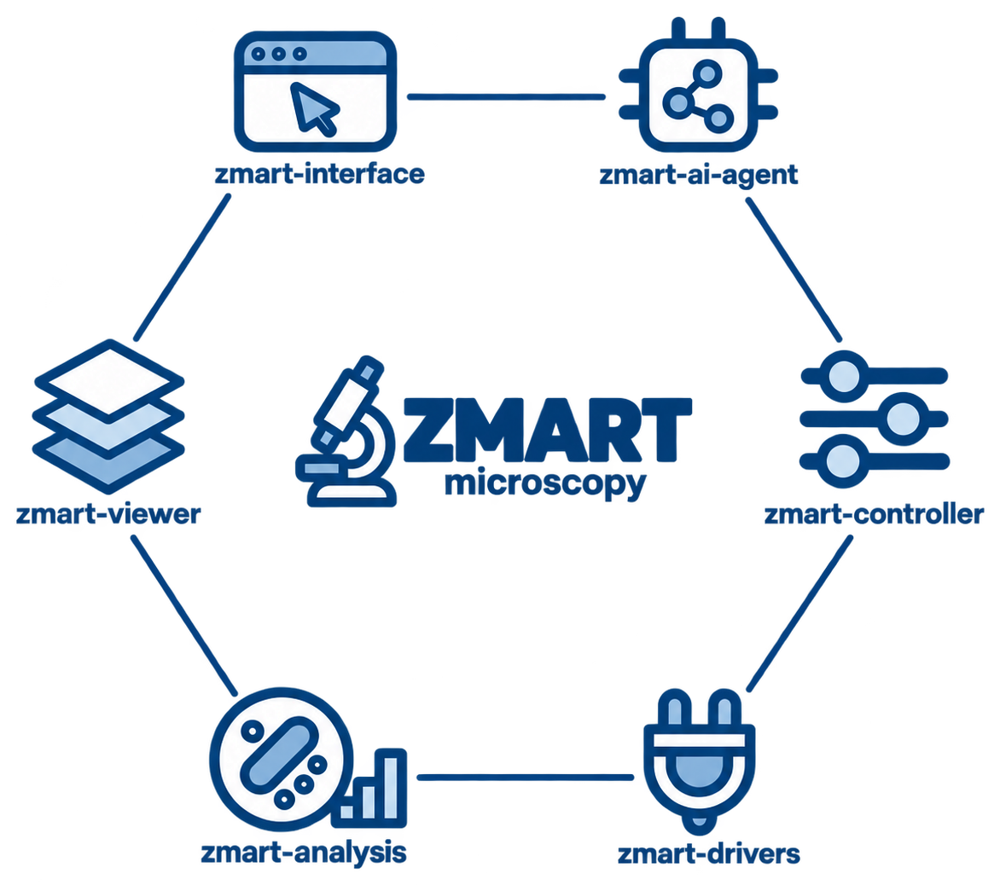
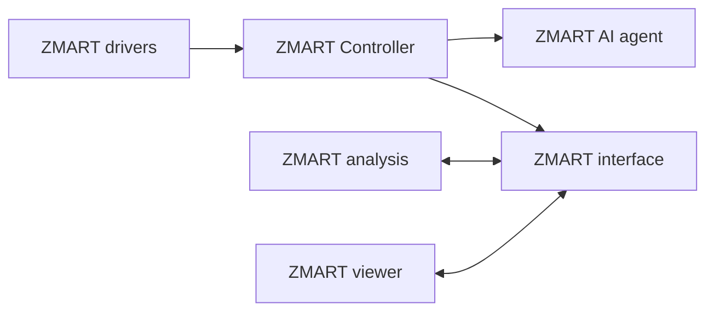

# ZMART Microscopy

[](https://www.python.org/downloads/)
[](LICENSE)
[](#testing)
[](.github/workflows/assembly.yml)
[](#status)


**ZMART** (ZMB's Microscopy-Agnostic Research Toolkit) is the set of tools we use for smart microscopy
at the Center for Microscopy and Image Analysis (ZMB), University of Zurich.
This repository puts them together.
<br clear="left"/>

## The Problem

Smart microscopy is a loop: take a picture, decide what is interesting, and image that next,
without someone at the microscope making every decision. Running that loop needs several things
at once: a way to drive the microscope, whatever its make; a window for the operator; analysis
between acquisitions; and a viewer for pictures that are still being taken. Built as one program,
all of this only works on the microscope it was written for, and a change to one part can quietly
break another.

## The Solution

ZMART is six building blocks, each in its own repository, each usable on its own:

<table>
<tr>
<td width="46%" valign="middle">

</td>
<td valign="middle">

<p><a href="https://github.com/ZMB-UZH/ZMART-drivers"><b>ZMART drivers</b></a><br>
One driver per microscope (Leica, Nikon, ZEISS, mesoSPIM), each translating the controller's commands into what that microscope understands</p>
<p><a href="https://github.com/ZMB-UZH/ZMART-controller"><b>ZMART Controller</b></a><br>
A short list of plain commands (move, read the state, acquire) that works the same on every microscope with a driver</p>
<p><a href="https://github.com/ZMB-UZH/ZMART-interface"><b>ZMART interface</b></a><br>
The operator window: scan an overview, find targets, image them again</p>
<p><a href="https://github.com/ZMB-UZH/ZMART-analysis"><b>ZMART analysis</b></a><br>
The analysis engine that runs between acquisitions (focus, object detection), each step in its own environment</p>
<p><a href="https://github.com/ZMB-UZH/ZMART-viewer"><b>ZMART viewer</b></a><br>
Shows a run as OME-Zarr while it is still being acquired</p>
<p><a href="https://github.com/thomdehoog/ZMART-ai-agent"><b>ZMART AI agent</b></a><br>
Drives a microscope when you ask in your own words</p>

</td>
</tr>
</table>

They plug together like this:



The microscope path runs from a driver, through the controller, to the interface. Nothing above
the controller needs to know which microscope is underneath. The analysis engine and the viewer
are side services plugged into the interface: it hands the analysis a focus stack or a field and
gets numbers back, and the viewer serves every capture to the operator's canvas. The AI agent
talks to the controller directly.

This repository assembles five of them (the AI agent is installed on its own): `install.py`
installs them from GitHub into one environment, the checks in `tests/` ask the questions where
they meet, and `run_walk.py` walks the operator window from start to finish on a pretend
microscope. The [workflows](workflows/) composed from the blocks will live here too.

The code that used to live in this repository, before the blocks had repositories of their own,
is kept in its git history and in the archive branch.

## Try it yourself

You need conda (Miniforge or Miniconda, used with conda-forge only) and an internet connection.
From a clone of this repository:

```bash
python install.py                    # the environment, the five blocks, and what the checks need
conda activate zmart-integration
python -m pytest tests               # the plug-in checks, a few minutes
python run_walk.py                   # the operator window, end to end, 10 to 30 minutes
```

To check the blocks together before they are promoted to `main`, install a branch of each:
`--branch release-candidate` takes that branch of every block, and `--branch zmart-analysis=main`
(given as well) keeps one block on another branch. The blocks are then installed at those
branches without their requirements first, and their requirements afterwards, because each block
names the others by their plain GitHub address and pip refuses one package asked for at two.

`install.py` creates the environment `zmart-integration` from [`environment.yml`](environment.yml)
(conda-forge only), installs the five blocks with pip straight from GitHub, clones the controller,
the analysis and the interface into `work/` (for their mock driver, workflows and browser walk,
which are not part of the packages), makes the analysis environments the walk needs if they are
missing, and installs the walk's Node.js tools and Chromium. What was installed, at which commit,
is written to `work/install-record.json`; the walk keeps a screenshot of every screen and its log
in `work/walk/<date>/`.

**On Windows computers where programs may only run from approved folders** (AppLocker), keep
this repository and the environment in an approved folder, and point `PLAYWRIGHT_BROWSERS_PATH`
and `TMPDIR` at approved folders too: the analysis engine starts each step with `conda run`,
which writes a small script to the temporary folder and runs it.

### Status

This is a release candidate. The latest run, on a Windows 11 workstation on 11 October 2026,
checked the blocks together before their promotion to `main`: the `release-candidate` branch of
the controller (0.2.0, `4b9ac5c`), the drivers (0.1.0rc1, `6710a7b`), the viewer (0.5.0rc4,
`5a291df`) and the interface (0.1.0rc1, `24a0a0f`), with the analysis engine from `main`
(1.0.0rc1, `80ab373`), whose `release-candidate` branch is older than its `main`:

```bash
python install.py --branch release-candidate --branch zmart-analysis=main
```

| What was checked | Result |
|---|---|
| The install, and `pip check` | passes |
| The plug-in checks (`tests/`) | all 30 pass |
| The walk: all ten steps of the operator window on the kidney mock, against the installed blocks | passes (about 3 minutes) |

On Windows, pip can fail to build the drivers with "could not create ... No such file or
directory": some of the drivers' file paths are long, and pip builds them inside the temporary
folder, so together they can pass Windows' limit of 260 characters. Point `TMP` and `TEMP` at a
short folder (such as `D:\t`) while installing, or turn on Windows' long paths. The analysis
environments still need `TMPDIR` in an approved folder when the checks run (see above).

The Nikon, ZEISS and mesoSPIM drivers still report their `planes` as a count rather than one
entry per picture, so their captures do not yet fit the controller's contract. That driver work is
planned; until then, the checks here plug those drivers in and list them, and take pictures only
on the two mock microscopes.

## Testing

The plug-in checks are in [`tests/`](tests), one file per place where blocks meet:

| File | What it asks |
|---|---|
| `test_installed_versions.py` | `pip check` passes; every block came from its GitHub repository; each clone is at the installed commit; the interface accepts the installed viewer; the versions are written down |
| `test_drivers_plug_in.py` | every driver plugs into the controller the way its shape asks: the Leica driver installs from its `zmart_driver.json` and is listed, and the Nikon, ZEISS and mesoSPIM modules have a function for every command; both mock microscopes pass the controller's `validate_driver`; the two mocks stand side by side, and no driver can take the name of the controller's mock |
| `test_analysis_runs.py` | the engine finds the sharp plane of a focus stack in its own environment, directly and through the interface |
| `test_viewer_serves.py` | a capture from either mock fits the controller's contract, is kept by the interface the way its bridge keeps a scan's field (the driver's own OME-Zarr store, or one written from its files), and is served by the viewer |
| `test_bridge_answers.py` | the interface's bridge lists the kidney mock first, serves the page, answers before Connect, passes a capture on as the controller's answer, keeps its own mock when another driver is installed under that name, and the walk's bridge runs the installed interface |

Every check gets an empty ZMART configuration folder of its own, and each driver is plugged in in
a fresh Python, so nothing on the computer changes the answer and nothing is left behind.

The continuous integration in [`.github/workflows/assembly.yml`](.github/workflows/assembly.yml)
runs every night and on demand: the plug-in checks on Ubuntu and Windows with Python 3.12, and the
walk on Ubuntu.

## Author
Thom de Hoog, Center for Microscopy and Image Analysis (ZMB), University of
Zurich (thom.dehoog@zmb.uzh.ch, thomdehoog@gmail.com).

## License
MIT License. See LICENSE file for details.

## Links

- [ZMART Controller](https://github.com/ZMB-UZH/ZMART-controller): the one vocabulary every microscope is driven with
- [ZMART drivers](https://github.com/ZMB-UZH/ZMART-drivers): the drivers that plug into the controller, one per microscope
- [ZMART interface](https://github.com/ZMB-UZH/ZMART-interface): the operator window
- [ZMART analysis](https://github.com/ZMB-UZH/ZMART-analysis): the analysis engine that runs between acquisitions
- [ZMART viewer](https://github.com/ZMB-UZH/ZMART-viewer): the viewer that shows the run as it is acquired
- [ZMART AI agent](https://github.com/thomdehoog/ZMART-ai-agent): driving a microscope by asking in your own words
- [Center for Microscopy and Image Analysis (ZMB)](https://www.zmb.uzh.ch), University of Zurich
