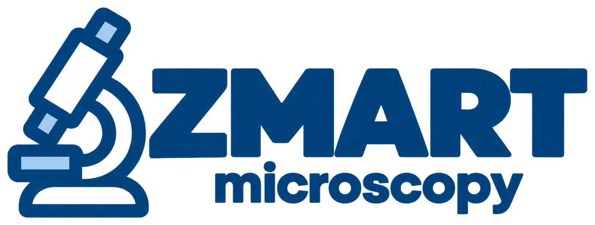
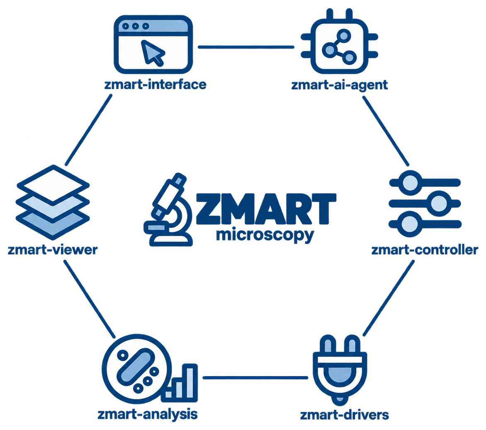
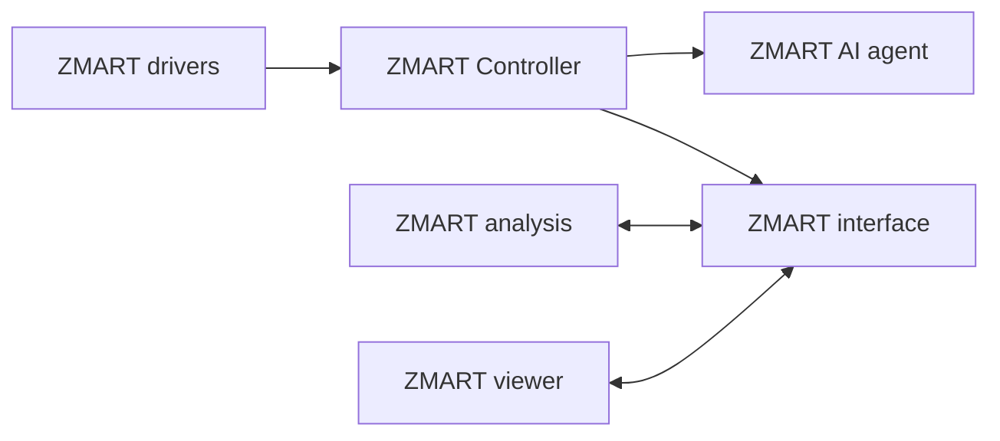

# ZMART Microscopy

[](https://www.python.org/downloads/)
[](LICENSE)
[](#testing)
[](.github/workflows/assembly.yml)
[](#status)



**ZMART** (ZMB's Microscopy-Agnostic Research Toolkit) is the set of tools we use for smart microscopy
at the Center for Microscopy and Image Analysis (ZMB), University of Zurich.
This repository puts them together.
<br clear="left"/>

## The Problem

Smart microscopy is a loop: take a picture, decide what is interesting, and image that next,
without someone at the microscope making every decision. Running that loop needs several things
at once: a way to drive the microscope, whatever its make; a window for the operator; analysis
between acquisitions; and a viewer for pictures that are still being taken. Built as one program,
all of this only works on the microscope it was written for, and a change to one part can quietly
break another.

## The Solution

ZMART is six building blocks, each in its own repository, each usable on its own:

<table>
<tr>
<td width="46%" valign="middle">

</td>
<td valign="middle">

<p><a href="https://github.com/ZMB-UZH/ZMART-drivers"><b>ZMART drivers</b></a><br>
One driver per microscope (Leica, Nikon, ZEISS, mesoSPIM), each translating the controller's commands into what that microscope understands</p>
<p><a href="https://github.com/ZMB-UZH/ZMART-controller"><b>ZMART Controller</b></a><br>
A short list of plain commands (move, read the state, acquire) that works the same on every microscope with a driver</p>
<p><a href="https://github.com/ZMB-UZH/ZMART-interface"><b>ZMART interface</b></a><br>
The operator window: scan an overview, find targets, image them again</p>
<p><a href="https://github.com/ZMB-UZH/ZMART-analysis"><b>ZMART analysis</b></a><br>
The analysis engine that runs between acquisitions (focus, object detection), each step in its own environment</p>
<p><a href="https://github.com/ZMB-UZH/ZMART-viewer"><b>ZMART viewer</b></a><br>
Shows a run as OME-Zarr while it is still being acquired</p>
<p><a href="https://github.com/thomdehoog/ZMART-ai-agent"><b>ZMART AI agent</b></a><br>
Drives a microscope when you ask in your own words</p>

</td>
</tr>
</table>

They plug together like this:



The microscope path runs from a driver, through the controller, to the interface. Nothing above
the controller needs to know which microscope is underneath. The analysis engine and the viewer
are side services plugged into the interface: it hands the analysis a focus stack or a field and
gets numbers back, and the viewer serves every capture to the operator's canvas. The AI agent
talks to the controller directly.

This repository puts five of them together (the AI agent is installed on its own).
`setup_zmart.py` installs them on a microscope computer, at the releases named in
`releases.toml`, and checks them end to end. And the [workflows](workflows/) we run live here: the blocks are general and are
installed, while the workflows are ours. There is one path for people who do not write code (the
operator window's workflow, *Target acquisition*, with its own analysis pipelines) and one for
people who write Python (notebooks, with their own copy of the pipelines). The blocks keep
examples of their own, for their tests and to learn from, and those are not installed.

The code that used to live in this repository, before the blocks had repositories of their own,
is kept in its git history and in the archive branch.

## Install ZMART

You need two things on the computer: **git** and **conda** (install
[Miniforge](https://conda-forge.org/download/), which brings conda with
conda-forge set up). On Windows, do the steps below in a **Miniforge Prompt**.

**1. Get ZMART Microscopy:**

```bash
git clone https://github.com/ZMB-UZH/ZMART-microscopy
cd ZMART-microscopy
```

**2. Run the installer:**

```bash
python setup_zmart.py
```

It asks whether you write code and which microscope this computer is for,
then installs everything, checks everything end to end, and puts a
**Start ZMART** icon on the desktop. At the end it says either
**"ZMART is ready."** or which parts did not work.

**3. If it did not work,** open [Claude Code](https://claude.com/claude-code)
in the `ZMART-microscopy` folder and say:

```
Read .claude/agents/zmart-install-doctor.md and follow it.
```

Claude Code then reads what the installer recorded (`local/setup-report.json`
and `local/setup.log`), finds out why, and fixes it with you, asking before it
changes anything.

To update later: `git pull`, then `python setup_zmart.py` again. To only
check an installation: `python setup_zmart.py --check`.

## For developers

How the blocks are checked together before a release (`install.py`, the
checks in `tests/` and the walk) is described in
[docs/checking-the-blocks-together.md](docs/checking-the-blocks-together.md).


## Author
Thom de Hoog, Center for Microscopy and Image Analysis (ZMB), University of
Zurich (thom.dehoog@zmb.uzh.ch, thomdehoog@gmail.com).

## License
MIT License. See LICENSE file for details.

## Links

- [ZMART Controller](https://github.com/ZMB-UZH/ZMART-controller): the one vocabulary every microscope is driven with
- [ZMART drivers](https://github.com/ZMB-UZH/ZMART-drivers): the drivers that plug into the controller, one per microscope
- [ZMART interface](https://github.com/ZMB-UZH/ZMART-interface): the operator window
- [ZMART analysis](https://github.com/ZMB-UZH/ZMART-analysis): the analysis engine that runs between acquisitions
- [ZMART viewer](https://github.com/ZMB-UZH/ZMART-viewer): the viewer that shows the run as it is acquired
- [ZMART AI agent](https://github.com/thomdehoog/ZMART-ai-agent): driving a microscope by asking in your own words
- [Center for Microscopy and Image Analysis (ZMB)](https://www.zmb.uzh.ch), University of Zurich
